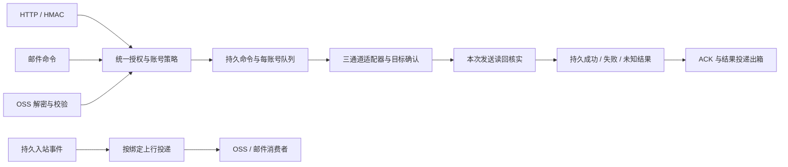

# QTrade 全面代码审查与整改方案

安琳，本轮结论是 **REQUEST CHANGES，架构状态 BLOCK**。共整理 **32 项去重主问题：HIGH 19、MEDIUM 13**，其中后端 2 项属于尚未完成的运行闭环；另列代码清理、待裁合同和验收缺口。未把自动询价回复本身当作越权，也没有要求恢复逐条人工确认。

## 审查基线与证据边界

- 时间：2026-10-13；分支 `claude/lucid-dijkstra-uu5max`；HEAD `6c5b941482d4f711a4481d18b771f9b48e16d917` **加当前未提交修改与新增源码**。10 月 8 日布局候选不作为现行版本。
- 当前主树仍为 `console/`、`src/`、`tests/`、`winagent/`。已冻结 538 份相关源码、测试、规格的 SHA；三条独立 lane 登记的审查路径去重为 83 份。这不是“538 份均逐行穷尽”的声明。
- 独立后端审查：49 文件、17 问题、13 组合成探针；前端/WinAgent 审查：32 个主体文件、12 问题；架构审查补充 3 项独有问题，并独立复现发送时序、目录和生命周期风险。
- 本轮不修改业务代码、测试或规格；没有连接真实 OSS/邮箱/业务账号，没有真实发送、ADB/Docker 操作、Windows UI/安装执行。只运行纯内存/Fake 探针及静态诊断。
- 当前新鲜诊断：111 个后端 Python 文件语法诊断通过；前端 typecheck 通过，lint 0 错误/36 警告；文档对账 exit 0。**这些通过不覆盖下述逻辑与权限缺陷。未运行本轮全量回归。**
- 使用最新 AGENTS 授权：Dify 询价回复可自动发送；成交拦截、账号/操作权限、发送对象准确性和真实回执仍必须成立。最新定稿明确“不改南银存款发送”，不能按更早待审草案扩大本批交付义务。

## 优先阻断项

| 类别 | 已取得的关键证据 | 对应问题 |
|---|---|---|
| 授权约束失效 | 只许 get_state 的 HMAC 客户端成功提交 send_text；qd01 令牌借工作流操作 qd02；邮件只读路由接受发送；受限令牌读到其它账号邮件正文 | BE-05～09 |
| 错误结果冒充成功 | 首次 SEND_FAILED，重放变 ok=true；超时排队项随后仍发送；旧同文读回让本次未确认发送变 delivered | BE-03、11、12 |
| OSS 执行链分叉 | 本机 Gate 拒绝但原始 sender 仍被调用；回执失败/重启后同指令重复执行；取消后的缺失结果被默认为 delivered | BE-01、02 |
| 目标与身份错误 | 微信目标点击未切换仍输入并发送；A 历史钥可与 B 的数据目录组合；实际旧 DLL 被记成请求的新 DLL | FW-01、09、10 |
| 配置与交付不闭环 | OSS“保存”只写浏览器；正式服务未接其环境配置；上行/选群邮件无生产消费者；通讯录发布器拿不到真实 book | FW-03、04；BE-16、17 |
| 安装门假通过 | 通配目录没有逐文件 hash，甚至仅检查父目录；缺失 console 仍可能通过 PAYLOAD_STAGED | BE-15 |

## 详细问题清单

每项的“证据”区分静态调用链、合成复现和真实未验证的影响；文件行号绑定本轮冻结版本。相同根因的跨 lane 发现已合并，避免重复计数。

### 权限与隐私

#### BE-05 · HIGH · HTTP 鉴权没有执行 allow_ops，Bearer 来源限制也未落实

位置：[src/qtrade_agent/api/app.py:182-188](/mnt/c/users/anlin/desktop/work/src/qtrade_agent/api/app.py:182)；[src/qtrade_agent/api/app.py:360-370](/mnt/c/users/anlin/desktop/work/src/qtrade_agent/api/app.py:360)；[src/qtrade_agent/api/app.py:716-729](/mnt/c/users/anlin/desktop/work/src/qtrade_agent/api/app.py:716)；[src/qtrade_agent/hmac_inbound.py:340-349](/mnt/c/users/anlin/desktop/work/src/qtrade_agent/hmac_inbound.py:340)。

- **触发/现状：** 配置某 HMAC 客户端 level=write 但 allow_ops=[get_state]，对已授权账号提交 send_text；或持有受 ip_allow 限制的 Bearer 从其它地址访问。
- **影响：** 界面登记的能力白名单不能约束调用方。Bearer 路径也只校验 hash、级别与账号，不消费来源白名单；限制字段造成虚假安全感。
- **根因/证据：** middleware 调 HmacVerifier.verify 时没有 op，后续 _submit 只 require_level/require_account；Principal 不携带操作/IP策略，Bearer 路径不执行该策略。 合成 probe hmac_allow_ops_ignored：有效签名返回 HTTP 200/ok=true，FakeBus 收到 send_text。Bearer 来源限制缺失由静态链确认。
- **整改：** 将鉴权与统一授权分开：验签只做一次，各入口按实际能力、账号、来源与限速策略授权；Bearer 与 HMAC 遵循各自契约但不能忽略已配置的约束。
- **验收：** HMAC allow_ops=[get_state] 发 send_text 必须 403 且零 submit；两个 auth_kind 都覆盖允许/禁止来源、显式危险能力和通配展开。

#### BE-06 · HIGH · HMAC 轮换的旧密钥被接受为 Bearer，绕开签名及 IP 检查

位置：[src/qtrade_agent/api/routes_ext.py:693-699](/mnt/c/users/anlin/desktop/work/src/qtrade_agent/api/routes_ext.py:693)；[src/qtrade_agent/api/app.py:341-368](/mnt/c/users/anlin/desktop/work/src/qtrade_agent/api/app.py:341)。

- **触发/现状：** HMAC 客户端轮换且 grace_minutes>0，旧密钥持有者在宽限期内用 Authorization: Bearer <旧钥> 请求。
- **影响：** 原应要求签名、nonce、时间戳和来源 IP 的客户端突然获得无签名 Bearer 通道。正常 HMAC 旧钥验签反而不支持宽限，因为 Vault 已被新钥覆盖。
- **根因/证据：** rotate 对两种 auth_kind 都写 old_hash；_grace_client 不检查 auth_kind，直接返回 HMAC 行交给 Bearer Principal。 合成 probe hmac_grace_as_bearer：来自 ip_allow 之外的源地址，旧 HMAC 密钥作为 Bearer GET /sessions 返回 200/ok=true。
- **整改：** Bearer 宽限仅限 bearer 类型；HMAC 若支持宽限，必须在验签器安全保留/读取前后版本密钥并完整执行 HMAC/IP/nonce 策略。Vault/DB/宽限登记需要处理失败一致性。
- **验收：** 轮换前后旧/新 HMAC 签名按期限成功，旧钥作为 Bearer 在任何时刻都 401；非法来源始终 403；Vault 写失败不能破坏当前有效凭据。

#### BE-07 · HIGH · 工作流入口不检查步骤账号，绕过 allow_accounts

位置：[src/qtrade_agent/api/app.py:989-996](/mnt/c/users/anlin/desktop/work/src/qtrade_agent/api/app.py:989)；[src/qtrade_agent/api/app.py:1028-1034](/mnt/c/users/anlin/desktop/work/src/qtrade_agent/api/app.py:1028)；[src/qtrade_agent/workflow/engine.py:276-290](/mnt/c/users/anlin/desktop/work/src/qtrade_agent/workflow/engine.py:276)。

- **触发/现状：** 令牌仅授权 qd01；管理员已有一个含 qd02 send_text 步骤的工作流；受限令牌调用该工作流 run。
- **影响：** 可借现存工作流从未授权账号发消息；resume 同样只认 write。Bus 信任 origin，不会补做账户授权。
- **根因/证据：** API 只检查 write 后传 actor 字符串；WorkflowEngine 构造步骤 Command 时没有调用方账号/操作策略上下文。 合成 probe workflow_account_scope_bypass：HTTP 202，FakeBus 实际收到 qd02/send_text，令牌只允许 qd01。
- **整改：** 执行前检查所有步骤的实际账号及操作权限，并在 resume/逐步执行时使用不可扩权的授权上下文；对受限令牌过滤相关 run/step 读取及控制。
- **验收：** qd01 限权令牌运行/续跑 qd02 流程均 403、零 Bus 调用；合法混合流程只有对所有步骤授权时成功。

#### BE-08 · HIGH · 邮件路由 level=read 仍接受 send_text

位置：[src/qtrade_agent/mail/ingest.py:254-298](/mnt/c/users/anlin/desktop/work/src/qtrade_agent/mail/ingest.py:254)；[src/qtrade_agent/mail/routes.py:82-85](/mnt/c/users/anlin/desktop/work/src/qtrade_agent/mail/routes.py:82)。

- **触发/现状：** 邮件路由被配置为 read，白名单发件人提交有效 HMAC 的 send_text，默认 allow_ops=[*]。
- **影响：** 用户以为只读的邮件接入口仍能驱动真实账号发送。
- **根因/证据：** MailIngest 只判 allow_ops，不将 cap.kind 与 route.level 比较；Bus 不负责入口鉴权。route.level 是存在但没有消费者的权限配置。 合成 probe mail_read_level_write：真实解析/HMAC 校验后的状态 ACCEPTED，pending 含 (send_text, read)。
- **整改：** 邮件验签与路由归属通过后，按能力 kind 执行 read/write/admin 授权，拒绝后不入 pending；危险确认不替代权限判定。
- **验收：** 同一签名指令分别进入 read/write/admin 路由，read 对 send_text 返回 FORBIDDEN/OP_DENIED 并零执行；只读能力保持可用。

#### BE-09 · HIGH · 邮件详情和控制 API 缺少账号范围授权

位置：[src/qtrade_agent/api/app.py:2145-2174](/mnt/c/users/anlin/desktop/work/src/qtrade_agent/api/app.py:2145)；[src/qtrade_agent/api/app.py:2176-2225](/mnt/c/users/anlin/desktop/work/src/qtrade_agent/api/app.py:2176)。

- **触发/现状：** 令牌仅允许 qd01，读取属于 qd02 的 mail_inbox 自增 id；相关列表、reparse、resend、discard 也只验证级别。
- **影响：** 泄露其它账号的指令正文和元数据；写级令牌还能干预其它账号邮件队列。
- **根因/证据：** 各邮件路由丢弃 _principal 返回值，没有使用 row.account_id / route 所覆盖账号作权限过滤。 合成 probe mail_account_scope_bypass：HTTP 200，返回 foreign_account=qd02 且 foreign_body_returned=true。写操作同因属静态确认。
- **整改：** 邮件列表 SQL、详情及写操作均按最终归属账号授权；全局/通道邮件需定义受限令牌可见范围，无法安全归属时拒绝；不要仅依赖 id 难猜。
- **验收：** qd01 token 对 qd02 邮件详情不可取得正文，对 qd02 resend/discard/reparse 零副作用；列表分页只包含有权行。

#### BE-10 · HIGH · capture_text 三级隐私策略失效，关闭全局仍向持久事件写正文

位置：[src/qtrade_agent/store/store.py:699-716](/mnt/c/users/anlin/desktop/work/src/qtrade_agent/store/store.py:699)；[src/qtrade_agent/store/store.py:792-793](/mnt/c/users/anlin/desktop/work/src/qtrade_agent/store/store.py:792)；[src/qtrade_agent/events.py:29-42](/mnt/c/users/anlin/desktop/work/src/qtrade_agent/events.py:29)；[src/qtrade_agent/events.py:64-80](/mnt/c/users/anlin/desktop/work/src/qtrade_agent/events.py:64)。

- **触发/现状：** 账号或会话 capture_text=false，或者全局 capture_text=false 后采集到消息。
- **影响：** 账号/会话的关闭设置下 messages.text 仍存正文；全局关闭时 messages.text 虽为空，events_outbox 仍保存原文并可经 WS/webhook/邮件传播，违反既定留痕限制。raw_ref 也未在此边界清除。
- **根因/证据：** Store 仅读取 self.capture_text 全局值，不按 session→account→global 解析；events.message_payload 从原始 Message 取 text，而该对象没有应用持久/外发策略。 probe capture_override_ignored：账号和会话 false 均仍存正文；全局 false 时 messages.text=null 但 events_outbox.text 存在。
- **整改：** 建立唯一有效消息策略并供 Store、补写路径、持久事件和所有外发复用；保留需要的 hash/length，关闭时 text/raw_ref 及派生正文都不得进入受限存储/出口。不能只修 API 显示。
- **验收：** 全局/账号/会话 true/false/null 组合；新插、重复补写、出向合并、WS/replay/webhook/mail/raw_ref 全检查。

### 发送事实、幂等与执行闭环

#### BE-01 · HIGH · 公网询价发送绕过总线安全闸、串行与审计

位置：[src/qtrade_agent/app.py:269-279](/mnt/c/users/anlin/desktop/work/src/qtrade_agent/app.py:269)；[src/qtrade_agent/app.py:362](/mnt/c/users/anlin/desktop/work/src/qtrade_agent/app.py:362)；[src/qtrade_agent/ossbox/inbox.py:228-233](/mnt/c/users/anlin/desktop/work/src/qtrade_agent/ossbox/inbox.py:228)。

- **触发/现状：** 具有询价封套密钥的调用方上传有效 send_text 指令，目标或正文被本机 sessions.allowlist / gate.blocklist 禁止。
- **影响：** 本机策略仍无法阻止对外发送；还可与 HTTP/邮件的同账号 UI 操作交错，且 commands 中没有本次记录。上游红线判断不能替代本机账号策略。
- **根因/证据：** AgentApp 将 qidian_ui.send_text 原始回调交给 XunjiaInbox，而非转换为 Command 后提交 Bus。Inbox 另写发送、落库和确认流程。 合成 probe oss_gate_bypass：Gate 返回 session_not_allowed，原始 sender 仍调用 1 次，commands 行数 0。
- **整改：** 询价入口只负责解密、验证身份并构造带原始幂等键的 Command；执行统一进 Bus。保留上游询价红线，但不得绕本机 Gate、串行、限速及读回确认。
- **验收：** 同一正文分别经 HTTP、邮件和 OSS 提交；白名单/词表拒绝时三条路径均零 sender 调用并有一致失败回执；并发同账号时不得交错操作。

#### BE-11 · HIGH · 失败指令幂等重投被改报为成功

位置：[src/qtrade_agent/bus/bus.py:175-178](/mnt/c/users/anlin/desktop/work/src/qtrade_agent/bus/bus.py:175)；[src/qtrade_agent/bus/bus.py:343-352](/mnt/c/users/anlin/desktop/work/src/qtrade_agent/bus/bus.py:343)。

- **触发/现状：** 首次发送返回 SEND_FAILED/TIMEOUT 等失败，客户端使用相同幂等键和正文重投。
- **影响：** 没有任何新成功发送，却收到 ok=true/IDEMPOTENT_REPLAY，业务可能据此改变询价/处理状态并停止补救；原错误信息丢失。
- **根因/证据：** _finalize 把除 needs_human/未确认以外的失败也落为 DONE，而 DONE 分支无条件构造 ok=true，没有恢复原始 ok/error。 probe failed_idempotent_replay：首次 ok=false/SEND_FAILED，再投 ok=true/IDEMPOTENT_REPLAY/error=false；send_calls=1。
- **整改：** 持久保存完整原始结果，重放保持原始成功/失败语义；按规格区分可重试、不确定和不可重试终态，避免把所有失败占成成功 DONE。
- **验收：** 首发 SEND_FAILED、TIMEOUT、GATE_BLOCKED、成功等结果逐一同键重投，重放不得把失败变成功；实际副作用和重试策略另行断言。

#### BE-12 · HIGH · 排队发送已返回 TIMEOUT，之后仍发生外发

位置：[src/qtrade_agent/bus/bus.py:229-245](/mnt/c/users/anlin/desktop/work/src/qtrade_agent/bus/bus.py:229)；[src/qtrade_agent/bus/bus.py:336-355](/mnt/c/users/anlin/desktop/work/src/qtrade_agent/bus/bus.py:336)。

- **触发/现状：** 同账号前一任务占队列，后一 send_text 在尚未开始时耗尽 timeout。
- **影响：** 调用方已获失败并可能换键重试，原队列项仍执行发送；命令审计已终态，后续 _finalize 被 done guard 拦截，结果与外部副作用分裂。
- **根因/证据：** submit 超时仅 _finalize Future，没有从队列取消/标记任务；_execute 不检查任务终态、截止时间和最新账号状态。 probe queued_timeout_still_sends：已返回 TIMEOUT 时调用数 0，释放前任务后调用数 1。
- **整改：** 未执行任务在过期/取消后必须不再进适配器；执行前核 deadline/取消与最新可写状态。已经开始的发送区分未知结果，不能伪装安全取消。账号 stop 与队列排空须同一协议。
- **验收：** 用假阻塞首任务复现；第二条先超时，放开首任务后第二条 sender_calls 仍为 0。再覆盖排队期间 stop/login_required/权限改变。

#### BE-02 · HIGH · 询价幂等状态不持久，回执故障或进程重启会重复发送

位置：[src/qtrade_agent/ossbox/inbox.py:88-90](/mnt/c/users/anlin/desktop/work/src/qtrade_agent/ossbox/inbox.py:88)；[src/qtrade_agent/ossbox/inbox.py:218-226](/mnt/c/users/anlin/desktop/work/src/qtrade_agent/ossbox/inbox.py:218)；[src/qtrade_agent/ossbox/inbox.py:299-307](/mnt/c/users/anlin/desktop/work/src/qtrade_agent/ossbox/inbox.py:299)；[src/qtrade_agent/ossbox/inbox.py:244-250](/mnt/c/users/anlin/desktop/work/src/qtrade_agent/ossbox/inbox.py:244)。

- **触发/现状：** 发送动作已返回成功，但读回尚未落库；ack 写失败或进程在发送后崩溃，随后重启重拉同一指令。
- **影响：** 对方收到重复询价。内存 Dedup 和 _outcome 丢失，DB 中原 SENDING 行不能阻止再次发送；同键异文也未校验。
- **根因/证据：** 只将 ext_msg_id 非空的出向行当作已发；发送前没有持久 claim，且 SENDING 在动作之后才写。去重命中但 outcome 不在时还默认返回 delivered，属于成功兜底。 合成 probe oss_restart_resend：同一对象两轮新建 Inbox，sender 2 次、DB 出向行仅 1 条。
- **整改：** 修复统一总线持久幂等协议：动作前原子占键与落 SENDING；记录稳定命令摘要及终态；不确定状态只能核实读回或报 pending/unknown，不得默认成功或直接重发。ack 可重试且不重新执行。
- **验收：** 在 claim、动作完成、读回、ack 写入四个位置分别中断并重启；同键最多执行一次；异文拒绝；ack 重试恢复同一结果。

#### BE-03 · HIGH · 旧的同文消息会被当成本次询价已送达

位置：[src/qtrade_agent/ossbox/inbox.py:309-318](/mnt/c/users/anlin/desktop/work/src/qtrade_agent/ossbox/inbox.py:309)；[src/qtrade_agent/store/store.py:820-829](/mnt/c/users/anlin/desktop/work/src/qtrade_agent/store/store.py:820)。

- **触发/现状：** 同一会话最近 120 秒内已发过相同正文；新指令 sender 返回动作成功，但新消息没有真实读回。
- **影响：** ack 变为 ok=true/code=delivered，询价端可错误转“询价中”，而本次 SENDING 行仍无 ext_msg_id。
- **根因/证据：** _landed 只按 account/session/norm(text)/±120 秒查任何历史出向行，不绑定本次 msg_id/幂等键，也不要求晚于发送前水位。 合成 probe oss_stale_readback：ack delivered=true，但新行 state=SENDING、ext_msg_id=null。
- **整改：** 只以本次预写消息行被读回合并后的 DELIVERED 为成功；按本次指令的唯一标识与发送前水位确认，不用历史同文代替。
- **验收：** 先种入一分钟前同文 DELIVERED，再令新动作无读回；新 ack 必须未确认/失败。随后只合并本次新 ext_msg_id 时才成功。

#### FW-01 · HIGH · 搜索点击后未确认会话已切换就粘贴并发送

位置：[winagent/src/qtrade_winagent/win/wechat.py:909](/mnt/c/users/anlin/desktop/work/winagent/src/qtrade_winagent/win/wechat.py:909)。

- **触发/现状：** _resolve_send_target 只验证通讯录显示名唯一；_search_popup_entries 扫整个窗口。909 点击结果后只 sleep(0.45)，911-916 按固定比例点击输入/发送，既不确认当前会话原生 id/标题，也不再次校验前台。Fake 把目标项 click 设为未导航，函数仍粘贴 FAKE ONLY 并点 send。697 的前台校验发生在这一串等待之前；705 读回检查在不可逆发送之后。
- **影响：** UI 卡顿、弹窗、焦点被用户切换或点击未生效时，可能把正文送到原会话/其它输入目标；读回失败只能事后报 SEND_FAILED。并且声称控件树不可见的文字路径仍依赖 descendants，空树只能拒绝，不能作为已接通的发送路径。
- **根因/证据：** 确证控制流缺少发送前目标确认；真实错发未执行 独立合成探针 probe_win.json:failed_navigation_still_inputs；原始结果见前端分报告。
- **整改：** 恢复发送前的明确目标与输入控件契约：选择结果后核实当前会话身份；每次正文输入和发送前校验目标窗口/前台；不可证明就明确拒绝，不能仅依靠发送后读回。具体支持的 UIA/版本边界交架构方决定，避免继续叠坐标兜底。
- **验收：** 独立 Fake 覆盖点击未导航、迟到结果、重名、无 UIA、弹窗和焦点抢占，均要求正文与发送动作次数为 0；授权真机阶段再覆盖不同窗口大小/DPI和目标回读。

#### FW-09 · HIGH · 被锁的旧 DLL 冒充本轮新 DLL，污染成功登录档案

位置：[winagent/src/qtrade_winagent/win/wechat.py:307](/mnt/c/users/anlin/desktop/work/winagent/src/qtrade_winagent/win/wechat.py:307)。

- **触发/现状：** stage_wx_key_dll 请求不同 DLL 且 copy PermissionError 时返回现有旧字节；chatlog_start:480 无条件 self._dll=dll（请求值），WeChatSession._next_key_round:511 同样记请求值；svc.py:683 成功登录将 out.key.dll 写入 WeChatStore.record_login 的 wxkey_dll，最终进入 last_wxkey_dll。Fake 请求 new.dll，返回成功但实际字节为 old-dll。
- **影响：** 换候选 DLL 实际没有换，却把失败归错版本或将未使用的 DLL 记录为成功登录所用 DLL；反复重试同一被占用 DLL，掩盖真正版本边界。不是重复报告已修的“相同字节无法覆盖”。
- **根因/证据：** 确证；回退本身与 R6-100 一致，需修订规格的风险已上报 独立合成探针 probe_win.json:dll_fallback；原始结果见前端分报告。
- **整改：** 同字节复用继续保留；不同字节无法落位必须明确阻断本轮或将实际候选身份贯穿全链路，禁止把请求 DLL 记成实际 DLL。R6-100 的“已有即可用”由架构/规格 owner 修订后再实现，审查 lane 不代定新架构。
- **验收：** 不同字节+被占用时验证启动/登录档案不记录新 DLL 成功；同字节+被占用仍幂等成功；真实加载身份与状态/审计/last_wxkey_dll 一一一致。

#### FW-10 · HIGH · 历史两把密钥可与另一个当前 wxid 的数据库组合启动

位置：[winagent/src/qtrade_winagent/win/wechat.py:567](/mnt/c/users/anlin/desktop/work/winagent/src/qtrade_winagent/win/wechat.py:567)。

- **触发/现状：** read_chatlog_keys 固定取 history[0] 两把非空钥；key_state:608-615 未对 wxid/轮次做校验。chatlog_serve:567 取历史钥，571 独立取 current_wxid，再577 直接组合配置。跨账号 Fake 明确给 A 的历史钥、当前 B 的数据目录，生成 server 配置仍为 B 目录+A 两钥。WeChatSession.poll:582 据 key_state.ok 进入 _serve，_serve:442 在子进程启动返回后直接 ready。
- **影响：** 登录/切换到 B 时，A 的旧 key 缓存会被当成可用密钥并提前结束取钥；结果可能是 B 永远无法解密却先显示成功，或绑定/采集身份错误。这里不是否定“同一账号经验证的合法密钥缓存”。
- **根因/证据：** 确证配置缺少账号身份校验；未宣称真实发生串号 独立合成探针 probe_key_identity.json；原始结果见前端分报告。
- **整改：** 把密钥缓存与确定的登录身份/数据目录绑定，复用前验证账号一致和实际可解密；新取钥尝试必须确认本轮产物或明确验证过的同账号缓存。不能以 history[0] 两字段非空代替就绪证据。
- **验收：** 独立 Fake 明确 A→B 切号、有 A 历史钥但 B 尚未取钥，要求不得 ready、不得用 A 钥启动 B；同账号有效缓存可复用，损坏/过期钥明确失败。

#### BE-13 · HIGH · QQ 首登删去关闭 WebUI 与固化 ACCOUNT 的安全收尾

位置：[src/qtrade_agent/accounts.py:413-426](/mnt/c/users/anlin/desktop/work/src/qtrade_agent/accounts.py:413)。

- **触发/现状：** 首次扫码确认 UID，尤其初始容器 ACCOUNT 为空或与实际登录号不一致。
- **影响：** 直接记 running 并清 webui_published_until_ms，但管理面保持登录期启用状态，且下次依赖 ACCOUNT 的免扫恢复没有建立。
- **根因/证据：** 工作区修改明确为避开重建期间健康误报而删除 set_napcat_webui 与新 OneBot 身份复核，属于绕过主契约的 workaround。 probe qq_finish_skips_security_close：state=running、runtime_security_close_calls=0、webui_expiry=null；git diff 直接删除原收尾链。
- **整改：** 修复收尾期间健康观察/登录态落盘时序，并恢复受管容器归属、ACCOUNT、WebUI 实际关闭与同 UID 复核；如确需改变产品策略，先由规格负责人裁决，不能清登记冒充完成。
- **验收：** 空/正确/错误 ACCOUNT 三分支，扫码后必须实际关闭管理面并核身份；取消/过期/容器归属变化不继续；实际镜像集成需独立授权验收。

### 运行装配、配置与上行

#### FW-03 · HIGH · 公网信箱保存与切换只改变 localStorage，不改变运行配置

位置：[console/src/pages/mail/MailPage.vue:232](/mnt/c/users/anlin/desktop/work/console/src/pages/mail/MailPage.vue:232)。

- **触发/现状：** saveOssbox 仅 localStorage.setItem(qtrade.ossbox) 和成功提示；AgentApp app.py:362-368 用 XunjiaInbox.from_env/CatalogPublisher.from_env 装配实际服务。全仓无后端消费 qtrade.ossbox；Fake 切到 OSS 后后端调用增量为 0。saveMailbox 则真实 PUT enabled=true；切回 OSS 没有禁用该邮件路由。
- **影响：** 页面更改终端编号/endpoint/bucket 后，实际仍按启动环境变量工作或根本未启用；互斥选择与真实收发状态脱节，原邮件链路可能继续运行。TCP 探测成功也不能证明桶/密钥/绑定/实际服务已配置。
- **根因/证据：** 确证 独立合成探针 probe.json:mail.oss_additional_backend_calls；原始结果见前端分报告。
- **整改：** 将配置入口接到唯一后端 owner 并回显应用状态，或明确做只读运行状态页并移除假保存。收敛传输模式在同一后端事务/应用动作切换，不以本地缓存控制实际能力。此项已通知总控与其它 lane 去重。
- **验收：** Fake 后端保存后读回一致；切换传输验证旧路径停止、新路径按已生效配置启动；重启/另一浏览器来源读回一致；无配置不能报告已保存可用。

#### BE-16 · MEDIUM · OSS 上行/存款及 QQ 下行仍是未装配骨架

位置：[src/qtrade_agent/app.py:361-368](/mnt/c/users/anlin/desktop/work/src/qtrade_agent/app.py:361)；[src/qtrade_agent/ossbox/bridge.py:52-106](/mnt/c/users/anlin/desktop/work/src/qtrade_agent/ossbox/bridge.py:52)；[src/qtrade_agent/ossbox/imap_out.py:23-51](/mnt/c/users/anlin/desktop/work/src/qtrade_agent/ossbox/imap_out.py:23)；[src/qtrade_agent/ossbox/inbox.py:195-199](/mnt/c/users/anlin/desktop/work/src/qtrade_agent/ossbox/inbox.py:195)。

- **触发/现状：** 把 specs/014 第一期说明作为已交付能力，期待所绑消息进入 out/、选中群邮件转发或 deposit/QQ 指令执行。
- **影响：** 现有正式 Agent 只注册 XunjiaInbox 和目录发布；plan_uploads、render_selected_group、should_send_imap 在运行代码无调用方，inbox 明确只收企点文本，功能不能因纯函数单测通过而称闭环。
- **根因/证据：** 协议/纯函数层已存在，生产调度、绑定持久化、消息事件接入、上传提交/重试与相应消费者尚未接线。 rg 全 src 对相关符号仅命中定义/__init__；app 注册表只有两条 OSS 任务。
- **整改：** 先由负责人确认待审规格实际获批范围；对承诺交付的部分补生产装配、绑定、水位/幂等、失败告警及消费者契约。不得用临时私有脚本当正式入口验收。
- **验收：** 从正式装配入口启动全假边界，注入消息→期望 out 或邮件对象→模拟消费者接收；重启后水位连续，未绑定账号/群不流出。
- **范围说明：** 功能未闭环；014 文档仍待审，不能按已批准的新硬需求归责；先确认获批范围，不能把待审的存款发送要求写成当前必须补做。

#### BE-17 · MEDIUM · 正式目录发布器拿不到企点/QQ 通讯录，只发布索引

位置：[src/qtrade_agent/ossbox/catalog_publish.py:155-166](/mnt/c/users/anlin/desktop/work/src/qtrade_agent/ossbox/catalog_publish.py:155)；[src/qtrade_agent/ossbox/catalog_publish.py:58-63](/mnt/c/users/anlin/desktop/work/src/qtrade_agent/ossbox/catalog_publish.py:58)；[src/qtrade_agent/ossbox/catalog_publish.py:90-93](/mnt/c/users/anlin/desktop/work/src/qtrade_agent/ossbox/catalog_publish.py:90)；[src/qtrade_agent/store/store.py:997-1014](/mnt/c/users/anlin/desktop/work/src/qtrade_agent/store/store.py:997)。

- **触发/现状：** 正式 CatalogPublisher.publish_once 从真实 Store 获取账号；期望生成企点/QQ contacts.json。
- **影响：** accounts/runtime 行没有 contacts/org 字段，生成空 book 后被 _has_book 门跳过；全新环境只有 index 指向不存在的通讯录文件，旧环境可能持续读取陈旧通讯录。
- **根因/证据：** 纯函数支持外部注入 contacts/org，但生产发布器只读 accounts 表，对企点 contacts/org、QQ contacts 从未接采集来源。空 book 跳过进一步隐藏未装配事实。 已核完整 publish_once、catalog_from_rows、publish_changed 与 Store.list_accounts SQL，无 contacts/org 装配。
- **整改：** 接到已有经授权的通讯录读取服务/缓存，显式区分读取失败、确实为空和已成功内容；未取得 book 时不能宣称索引引用已就绪；留可诊断的发布结果。
- **验收：** 使用正式 Store 返回形态与假通讯录服务，首轮应同时发布 index 与实际 book；读取失败不被当空目录；真实清空联系人需明确版本/删除语义。
- **范围说明：** 功能未闭环；实际生产调用链静态证实；先确认获批范围，不能把待审的存款发送要求写成当前必须补做。

#### FW-04 · HIGH · “同一邮箱发信”没有保存 SMTP 凭据和收件人

位置：[console/src/pages/mail/MailPage.vue:176](/mnt/c/users/anlin/desktop/work/console/src/pages/mail/MailPage.vue:176)。

- **触发/现状：** 页面仅将密码放 scope.pass，未设置 scope["smtp-pass"]；scopeToWire 的 outbound 仅 host/port/from/recipients/template_id，且全新 scope.recipients 为空，页面没有填写收件人的入口。Fake 保存结果 outbound 无 user、secret，recipients=[]。mail/routes.py:_outbound_from_json 不继承 inbound 凭据；mail/sender.py:69 对空收件人直接 MAIL_ROUTE_UNRESOLVED 并不入队。
- **影响：** 全新机器按页面填写并“保存邮件中转”后，宣称的微信群邮件转发不会发出。IMAP 登录通过无法证明 SMTP 已有认证与目标地址。
- **根因/证据：** 确证全新配置不能形成发信路径 独立合成探针 probe.json:mail.saved_scope；原始结果见前端分报告。
- **整改：** 按真实路由契约完整保存发信账号/凭据引用和明确收件人，并从绑定/选群消费实际来源；不要假定 inbound 密码自动用于 outbound。若本期仅配置收信，界面须准确收窄功能承诺。
- **验收：** 空库 Fake 新建路由，验证出站认证引用、目标收件人、所选群模板齐全；Mock SMTP 接到预期 sender/to，未配置收件人不得成功启用转发。

#### FW-05 · MEDIUM · 邮箱测试未指定刚保存的路由且会先启用真实收信

位置：[console/src/pages/mail/MailPage.vue:209](/mnt/c/users/anlin/desktop/work/console/src/pages/mail/MailPage.vue:209)。

- **触发/现状：** testMailbox 先 await saveMailbox()（PUT mail.enabled=true + reload），再 mailApi.test("inbound")，没有 route_id。api/app.py:2012-2013 在 route_id=None 时取 mail.routes.routes 第一条；存在默认路由时并非刚改的微信路由。Fake test_args 仅 ["inbound"]。
- **影响：** 可能显示其它邮箱的测试结果；用户只想测试配置却提前启用了收信/指令调度，UI“只登录邮箱”的说明与整个按钮副作用不符。
- **根因/证据：** 确证 独立合成探针 probe.json:mail.test_args；原始结果见前端分报告。
- **整改：** 测试使用已保存或临时验证的明确路由 id，保存、测试、启用分开；测试动作不改变收发启用状态。
- **验收：** 预置默认路由 A 与微信路由 B，测试 B 时仅调用 B 的 Fake IMAP/POP3，并断言全局/路由 enabled 原值不变。

#### BE-04 · MEDIUM · 同步 OSS 网络调用阻塞 Agent 主事件循环

位置：[src/qtrade_agent/app.py:397-402](/mnt/c/users/anlin/desktop/work/src/qtrade_agent/app.py:397)；[src/qtrade_agent/ossbox/inbox.py:138-166](/mnt/c/users/anlin/desktop/work/src/qtrade_agent/ossbox/inbox.py:138)；[src/qtrade_agent/ossbox/oss_http.py:58-90](/mnt/c/users/anlin/desktop/work/src/qtrade_agent/ossbox/oss_http.py:58)。

- **触发/现状：** 启用 OSS 下行后，一次 list/get/put 变慢，或者七天保留期间对象持续累积。
- **影响：** urllib 的单次 30 秒等待期间，API、WS 心跳、账号健康与读回轮询都不能运行；每轮还对所有历史指令串行 GET ack，延迟随对象数增长。
- **根因/证据：** async poll 中直接调用同步 box 方法；scheduler 只把该 coroutine 起任务，不会使其同步 I/O 自动离开事件循环。 静态确认完整调用链；未连接真实 OSS，也未据此声称生产已发生超时。
- **整改：** 将对象箱 I/O 置于受限线程或异步客户端，保留按账号总线串行；为一轮设置总预算、批量上限和持久扫描水位，避免每 5 秒重扫全部已完成对象。
- **验收：** 假 box 的单次调用延迟 200ms/30s 时，独立心跳和 API 任务仍推进；历史对象扩至万条后每轮请求数有上限。

#### AR-07 · MEDIUM · 目录缓存忽略密钥轮换和远端对象生命周期

位置：[src/qtrade_agent/ossbox/catalog_publish.py:80-99](/mnt/c/users/anlin/desktop/work/src/qtrade_agent/ossbox/catalog_publish.py:80)；[src/qtrade_agent/ossbox/catalog_publish.py:169-182](/mnt/c/users/anlin/desktop/work/src/qtrade_agent/ossbox/catalog_publish.py:169)。

- **触发/现状：** 明文目录不变但密钥更换，或远端对象被生命周期规则删除。
- **影响：** 新钥客户端仍拿到旧封套，或目录缺失后永久不再发布；空账号集合也不会发布新的空索引。
- **根因/证据：** 缓存仅存明文摘要，没有密钥版本、远端存在性、刷新期限和有效空快照语义。 独立架构合成探针：换两把密钥后新增上传0次；模拟远端删除后恢复对象0个。真实桶生命周期未读取。
- **整改：** 目录发布纳入密钥版本及最大刷新期；远端缺失可恢复，明确空快照/删除与失败的区别。
- **验收：** 换两把密钥、远端删除、真实清空账号与读取失败分别注入；应重发、恢复或明确失败。

### 前端功能与生命周期

#### FW-02 · HIGH · 视频流未承接 Electron 配置的 Agent 地址

位置：[console/src/codec/stream.ts:43](/mnt/c/users/anlin/desktop/work/console/src/codec/stream.ts:43)。

- **触发/现状：** streamUrl 仅使用 location.host 或 ws://127.0.0.1:17600，完全不读 qt.endpoint.agent；HTTP agentOrigin 与 api/ws.ts defaultEventsUrl 已读该字段。Fake 配 Agent=17650、页面=5313，视频 URL 实际为 5313；file:// 时实际为 17600。Electron netguard 仅给配置的 Agent 源注入 Bearer，正式 CSP 也只放配置源。
- **影响：** 自定义端口的正式壳连错端口/被 CSP 拦；开发 Electron 视频连到 Vite 且拿不到主进程注入的 Agent token。新截图兜底掩盖主视频路径不通，不能视为视频已正常。
- **根因/证据：** 确证 独立合成探针 probe.json:stream_dev,stream_file；原始结果见前端分报告。
- **整改：** 画面流与 HTTP、events 复用同一个 Agent 源解析，再只追加受控 stream 路径；错误源不得默默回退写死端口。
- **验收：** Fake 覆盖 file://、Electron+Vite、默认端口、自定义端口；验证视频 WS、HTTP、events 的 origin 一致且都命中 token 注入/CSP。

#### FW-06 · MEDIUM · 新登录尝试继承上一尝试的二维码

位置：[console/src/stores/accounts.ts:183](/mnt/c/users/anlin/desktop/work/console/src/stores/accounts.ts:183)。

- **触发/现状：** 新增补图逻辑只比 next.kind===prev.kind，没有要求 incomingSession===previousSession。Fake attempt-old 带图，attempt-new 同 kind 无图，loginSessions 已变 new，prompt 仍含 FAKE_OLD_QR。
- **影响：** 新尝试显示过期二维码，违背 N-3/R6-83 的登录尝试隔离；用户扫码作用到旧会话或一直无法完成当前登录。
- **根因/证据：** 确证 独立合成探针 probe.json:qr_new_attempt；原始结果见前端分报告。
- **整改：** 二维码按 (account_id, login_session_id) 管理；切换 session 立即丢弃旧图。只有同一已确认尝试的持久化重放缺图时才保留本轮图。
- **验收：** 新旧不同 session、同 session 重放、退出登录、过期和迟到 prompt 请求五组场景，保证新尝试从不继承旧图。

#### FW-07 · MEDIUM · 旧查询响应覆盖当前账号的消息与会话结果

位置：[console/src/stores/messages.ts:77](/mnt/c/users/anlin/desktop/work/console/src/stores/messages.ts:77)。

- **触发/现状：** search 在请求前复制 filter，却在返回时无代次校验直接 items=...；loadSessions 同样如此。MsgPage.changeAccount 允许连续选择账号并并发调用。Fake 先请求 A 再 B，B 先回、A 后回，最终 filter 为 B 而 items 为 A。
- **影响：** 界面标题显示 B 却展示 A 的历史消息；翻页还可能拼接不同查询的数据，用户据此审计或导出会得到错误范围。
- **根因/证据：** 确证 独立合成探针 probe.json:late_search；原始结果见前端分报告。
- **整改：** 请求使用查询 generation/稳定 query key，返回时仅当前代可更新 items、cursor、loading/error；旧代取消或忽略，翻页绑定其查询快照。
- **验收：** 延迟 A、立即 B、A 最后完成；增加同账号切会话/关键词/日期与旧翻页返回场景，结果和 cursor 必须始终属于最新查询。

#### FW-08 · MEDIUM · 消息导出把下载地址/空字符串写成 ZIP 文件

位置：[console/src/pages/msg/MsgPage.vue:56](/mnt/c/users/anlin/desktop/work/console/src/pages/msg/MsgPage.vue:56)。

- **触发/现状：** onExportDone 直接 saveAs(...zip,"application/zip",String(job.result?.download_url??""))；electron/main/files.ts:15 原样 writeFile 字符串，不下载。真实 messages_export result 为 {rows,bytes,file_path}（routes_ext.py:805），不含 download_url；后者来自 /exports/{job_id}（routes_ext2.py:760）。Fake 即使给 download_url 也只保存 URL 字符串。
- **影响：** 正常导出成功后用户得到 0 字节或只含 URL 的 .zip，实际请求 fmt=csv 却扩展名也错误。
- **根因/证据：** 确证 独立合成探针 probe.json:export_save_arguments；原始结果见前端分报告。
- **整改：** 按 job.id 获取 /exports/{id}/file 的真实字节，走现有鉴权下载客户端，成功后保存 .csv 与正确 MIME；缺下载产物须显式失败。
- **验收：** Fake 真 Job 形状 + 二进制下载，校验保存字节等于 CSV 产物且非 URL；覆盖空产物、过期、下载失败。

#### FW-11 · MEDIUM · 关闭开机自启后立即把持久配置和开关写回 true

位置：[console/src/pages/set/SetPage.vue:17](/mnt/c/users/anlin/desktop/work/console/src/pages/set/SetPage.vue:17)。

- **触发/现状：** SetPage 将 setAutoLaunch(value) 的返回值当 applied 保存；主进程 index.ts:191-194 无论 on=true/false 都 return true。用户关闭时 OS 收到 false，但随后 ui.persist({app:{auto_launch:applied}}) 和 ui.autoLaunch 写成 true。
- **影响：** 开关关闭后马上弹回开启，配置与 Windows 注册状态相反，后续重启/初始化依据不一致。
- **根因/证据：** 确证 静态调用链确证，未运行真实桌面。
- **整改：** 定义 IPC 返回值为实际 openAtLogin 并主进程回读，或保持“操作成功”返回契约而页面保存提交值；两端类型与测试同步，不能混用成功标志和开关状态。
- **验收：** Fake IPC/Windows adapter 双向 on→off→on，检查 OS 设置、console.toml 与页面开关三者一致。

#### FW-12 · MEDIUM · 最小化/隐藏画面暂停桥只有监听端，没有任何发送端

位置：[console/electron/preload/index.ts:45](/mnt/c/users/anlin/desktop/work/console/electron/preload/index.ts:45)。

- **触发/现状：** preload.qt.window.onVisibility 注册 qt:visibility；ScreenPage:226 检测该方法存在就直接返回 IPC listener，不再注册 document.visibilitychange。console/electron/main 全目录 rg qt:visibility 无命中，index.ts 的 hide/show/minimize/restore 从不发送该事件。
- **影响：** 正式 Electron 托盘隐藏后 hidden 始终 false，视频不发 pause，静态预览仍每 2 秒请求，违反 01 §2.7.4/R6-69，持续消耗采集/解码与后台资源。
- **根因/证据：** 确证生产桥缺发送端 静态调用链确证，未运行真实桌面。
- **整改：** 主进程在当前窗口 show/hide/minimize/restore 发送真实可见性并提供首次订阅状态；销毁/重建解绑正确。或以已验证的渲染可见性为统一事实来源，但不能保留无发送者的假桥。
- **验收：** Fake BrowserWindow 事件→preload→ScreenPage，隐藏期间 pause 且截图调用停止，恢复只 resume 一条现存流；启动即隐藏也应暂停。

#### BE-14 · MEDIUM · 消息查询先限量后权限过滤，会截断有权账号的历史

位置：[src/qtrade_agent/api/app.py:818-823](/mnt/c/users/anlin/desktop/work/src/qtrade_agent/api/app.py:818)。

- **触发/现状：** 受限 token 不传 account_id，当前 limit 页全部或部分属于其它无权账号，后面仍有有权消息。
- **影响：** 返回空页/不足一页且 next_cursor=null，客户端无法再向后取得有权消息。
- **根因/证据：** query_messages 先取未授权混合页，过滤后用 len(rows)==limit 判断还有下一页，和本文件 _next_cursor 对权限过滤前分页的说明矛盾。 probe account_filter_ends_pagination：库内有权消息 1 条，HTTP 200/data_count=0/next_cursor=null。
- **整改：** 优先把账号权限谓词放入 SQL 并在授权集合内分页；至少按原始页生成游标，避免过滤消失等同到达末页。
- **验收：** 有权旧消息、无权较新消息，limit=1/2，必须能遍历全部有权消息且无重复、无泄漏。

#### AR-08 · MEDIUM · Agent 停机没有等待恢复和账号后台任务

位置：[src/qtrade_agent/app.py:809-837](/mnt/c/users/anlin/desktop/work/src/qtrade_agent/app.py:809)；[src/qtrade_agent/accounts.py:1257-1311](/mnt/c/users/anlin/desktop/work/src/qtrade_agent/accounts.py:1257)。

- **触发/现状：** recover 正在恢复账号时触发 Agent stop，或仍有账号启动/登录后台任务。
- **影响：** 数据库和适配器关闭后任务仍可继续操作，造成关库后写入、停机不干净或状态失真。
- **根因/证据：** 裸create_task的恢复任务未保存句柄；stop未统一取消/等待恢复与accounts.tasks。 独立架构假生命周期探针：unjoined_recover_tasks=1，recover_continued_after_store_closed=true。
- **整改：** Agent生命周期统一拥有任务；draining后拒新任务，在关适配器/库前有界取消和等待。不得把停Agent改成停全部业务容器。
- **验收：** 在恢复/启动各await处挂起后stop，断言关库前任务全部结束，关库后无写入/连接/新任务。

#### AR-09 · MEDIUM · WinAgent 已连接阶段管道写失败会退出重连循环

位置：[winagent/src/qtrade_winagent/main_user.py:54-83](/mnt/c/users/anlin/desktop/work/winagent/src/qtrade_winagent/main_user.py:54)；[winagent/src/qtrade_winagent/pipe.py:343-362](/mnt/c/users/anlin/desktop/work/winagent/src/qtrade_winagent/pipe.py:343)；[winagent/src/qtrade_winagent/win/pipes.py:33-38](/mnt/c/users/anlin/desktop/work/winagent/src/qtrade_winagent/win/pipes.py:33)。

- **触发/现状：** 管道Peek检查后、心跳WriteFile前服务断开，或已连接阶段send抛OSError。
- **影响：** 普通断连变成会话代理进程崩溃；需依赖外层任务重启，可能丢失内存登录状态，并非永远无法恢复。
- **根因/证据：** 重连try只覆盖ua.start，不覆盖ua.run；心跳send错误向外传播。 独立架构假管道探针：OSError越过run_forever，connect_count=1。
- **整改：** 把已连接阶段纳入连接生命周期try/finally，释放旧连接和在途任务后退避重连，保留取消和权限拒绝语义。
- **验收：** 假管道连续在心跳send断开，连接次数持续增加、旧句柄清理、取消可退出，不重新登录业务账号。

### 安装交付

#### BE-15 · HIGH · 安装载荷通配目录不验哈希，甚至只校验其父目录

位置：[installer/build/collect-payload.ps1:218-236](/mnt/c/users/anlin/desktop/work/installer/build/collect-payload.ps1:218)；[installer/engine/modules/QTrade.Payload.psm1:59-70](/mnt/c/users/anlin/desktop/work/installer/engine/modules/QTrade.Payload.psm1:59)；[installer/engine/modules/QTrade.Payload.psm1:91-99](/mnt/c/users/anlin/desktop/work/installer/engine/modules/QTrade.Payload.psm1:91)；[installer/build/build.ps1:586-589](/mnt/c/users/anlin/desktop/work/installer/build/build.ps1:586)；[installer/build/build.ps1:653-712](/mnt/c/users/anlin/desktop/work/installer/build/build.ps1:653)。

- **触发/现状：** manifest 项 path=console/*、dest=%ProgramData%\QTrade\console；console 不存在而 QTrade 根存在，或目录内 DLL/app.asar 被删除/改变。
- **影响：** PAYLOAD_STAGED 仍可判通过，遗漏控制台、WinAgent 依赖和第三方载荷损坏；外壳签名不等于运行目录的持续完整性校验。
- **根因/证据：** 收集器对 tree/glob 不生成逐文件 hash；安装器对 dest 目录再 Split-Path -Parent，SkippedGlob/SkippedNoHash 不算失败；归档路径门跳过通配，G6 只核部分签名及 engine hash。 应 root 新分配独立读三文件交叉核，静态证实；未执行 PowerShell、安装器或现存成品，也未声称已发现成品篡改。
- **整改：** 最终签名完成后生成完整逐文件 manifest；定义固定 required_files；安装期校验实际目标文件和哈希，必需项不得允许 Skipped*。保持签名、清单与最终归档一致。
- **验收：** 合成暂存树分别删除 console 整目录、单 DLL、改 app.asar 一字节，三者必须阻断；签后重收集/重打包校验同一清单。

## 架构交叉核验的额外证据

以下并入 BE-01～03，不另计主问题数：

- 发送前不落SENDING；读库先于sender返回时产生DELIVERED+SENDING两行，ACK仍成功：`message_rows=2`（BE-01/BE-02/BE-03）。
- sender CancelledError后同Inbox重试，无消息却默认成功：`messages=0, ack.ok=true, code=delivered`（BE-02）。
- 模拟外部发送后/落库前取消，再建Inbox：`synthetic_effect_count=2`（BE-02）。

## 冗余、死入口与维护性整改

这些项目应在安全和数据事实稳定后处理，不与上述 32 项重复计数。

| 项目 | 证据与判断 | 处理方式 |
|---|---|---|
| 无界面消费者的前端状态 | [console/src/App.vue:129](/mnt/c/users/anlin/desktop/work/console/src/App.vue:129) 仍绑定 commands/workflows；生产代码检索这两个 store 仅在 App 导入/绑定，已无对应页面消费者。 | 先移除无用订阅与缓存，再审查 store 导出和测试依赖；保留仍有外部合同的 commands/workflow 后端 API。 |
| 协议骨架与真实能力混放 | `ossbox/services.py` 的 from_oss/from_mail/reconcile，bridge/imap_out 的规划/渲染函数，没有生产调用链。 | 标清“协议库/待接线”和“已运行能力”；决定承诺范围后接线或收缩导出，不凭单测通过显示可用。 |
| 两套发送事实实现 | Bus 与 XunjiaInbox 各自维护去重、发送、确认、结果；已出现实证分叉。 | OSS 保留传输职责，复用修正后的命令执行核心；删除被替代的独立发送/确认逻辑，而非再加第三层补丁。 |
| 手写密码原语 | `ossbox/crypto.py` 自行实现 AES/GHASH；本机单次合成 64 KiB seal/open 各约 0.34s，且调用链运行于同一事件循环。 | 作为安全审计/维护风险评估，不声称算法已被破解；优先评估成熟 AEAD 实现、互操作向量、信封版本与大小限制，再按项目规则决定依赖。 |
| 恢复入口和工程杂物 | 项目 resume skill 仍主要指向10月8日状态，而主交接已到10月10/12；根目录存在多份 .tmp_* 调试脚本。 | 统一现行入口；先核每份脚本的在途用途、敏感信息及归属，再按精确清单归档。不要批量删除历史证据、运行数据或其它客户端文件。 |

## 先裁决、再实施的合同

- specs/014的both默认与bridge.py仅oss/imap相冲突；开发说明仍待审，先确定获批范围，不能自行补做存款发送。
- 最新10月12定稿明确本次不改南银存款发送；Dify留在询价端，外部仓库未审，不能认定其功能不存在。
- 目录说明catalog.json与现行index.json+分账号对象需版本化消费契约。
- 超时/撤销协议缺通用截止时间，硬编码历史cmd黑名单不能替代过期策略。
- R6-100允许不同DLL被占用时回退，但实际旧DLL与记档新DLL不一致必须收口；不能将回退本身误报为未遵守现行规格。
- 退役UI不等于退役后台commands/workflow API，删除前须确认外部调用方。

## 分批整改方案

| 批次 | 责任与修改范围 | 前置条件 | 完成判据 |
|---|---|---|---|
| 1：权限和不可逆发送保护 | 后端授权 owner 统一 op/account/IP/level 检查及 HMAC 轮换；消息策略 owner 修正文留痕；Windows owner 补发送前目标验证 | 明确当前授权矩阵，不恢复逐条人工确认 | BE-05～10、FW-01 的所有越权/错误目标探针变为拒绝且零外发；正常自动回复继续可用 |
| 2：发送事实与恢复 | 先修 Bus 原结果重放、排队 deadline/取消，再将 OSS 接共享账号队列；持久命令/待投递 ACK；修取钥身份、DLL身份与QQ收尾 | 批次1的授权上下文能够传到最终执行点 | 同键异参拒绝；ACK失败只重投ACK；未知发送先读回核实；失败不变成功；不误用旧钥/旧DLL/旧会话 |
| 3：正式配置与跨网闭环 | 后端配置单一来源、服务启动配置注入、真实通讯录服务；按已批准绑定补消息上行与邮件出箱；分离测试/保存/启用 | 对 both/互斥、目录版本、对象保留和消费者职责形成一致合同 | 从正式 AgentApp/服务入口用Fake边界走完整收发链；重启后配置、水位、ACK持续；页面显示真实生效状态 |
| 4：前端与生命周期 | 修统一 endpoint、二维码按尝试隔离、查询代次、真实导出字节、自启返回值、窗口可见性；补Agent停机和WinAgent重连 | 复用现有业务模块，不扩大成重写 | 同一套慢响应/旧会话/窗口隐藏/重连故障用例通过；身份与结果三端一致 |
| 5：安装、清理与验收 | 签后逐文件manifest/required_files；清理死订阅与重复实现；冻结源码+依赖+产物 | 前四批缺陷闭环 | 独立验收维护故障注入；同一冻结版本完整回归；删目录/坏DLL/改app.asar必须被安装门拒绝；再进入获准的真实安装/账号验证 |

每批采用实现、开发者测试、独立验收、文档回写、只读终审分工。失败用例由独立维护者保留，不修改断言来掩盖产品失败。无需先做目录迁移，也没有证据要求新增微服务；可先沿用 SQLite、Bus 和既有邮件出箱。

建议的统一链路：

**不可承诺的语义：** UI 点击与 SQLite 不是一个事务。崩溃发生在外部副作用之后时，应进入 UNKNOWN 并以本次消息标识/水位只读核实；不能靠内存集合宣称天然 exactly-once，也不能自动重发掩盖不确定性。

## 发布与验证缺口

1. 本轮只读列到的安装成品仍为 `installer/out/QTrade-Setup-1.0.1.exe`，mtime 为2026-09-27、2,250,367,904字节；没有重算其整包哈希或执行它，不能把当前源码修复视为该旧包已包含。
2. 既有 VM 日志证明完整 WSL 能启动，但微型 kcheck 曾超时。当前构建脚本仍有 `/init -> /bin/busybox`，其因果未实证；前置拦截改善不等于镜像本身已修好。真实 kcheck、内核切换、完整真装必须另有证据。
3. 外部询价/存款仓库及真实 Dify 运行未审；其权限、prior_outbound_text、消费幂等和最终页面 delivered 需要跨仓合同验收，不在此虚构结论。
4. 本轮没有全量pytest/Pester/构建或真实UI执行；编译、类型和文档门通过只说明相应静态条件成立。真实Windows版本/DPI、QQ扫码重建、邮件/OSS网络和故障恢复需后续明确范围的验收。
5. 这是对本轮范围的有证据审查，不宣称所有可能缺陷已经穷尽，更不宣称“零回归”。

## 分报告与证据

- [后端与安全审查](/mnt/c/users/anlin/desktop/work/.codex/review-20261013/backend-security.md) / [结构化结果](/mnt/c/users/anlin/desktop/work/.codex/review-20261013/backend-security.json)
- [前端/Electron/WinAgent审查](/mnt/c/users/anlin/desktop/work/.codex/review-20261013/frontend-winagent.md) / [结构化结果](/mnt/c/users/anlin/desktop/work/.codex/review-20261013/frontend-winagent.json)
- [架构交叉核验与方案](/mnt/c/users/anlin/desktop/work/.codex/review-20261013/architecture.json)
- [初始源码清单](/mnt/c/users/anlin/desktop/work/.codex/review-20261013/source-before.json)；[文档对账日志](/mnt/c/users/anlin/desktop/work/.codex/review-20261013/docs-check.log)

最终门结论：代码 lane = **REQUEST CHANGES**；架构 lane = **BLOCK**；综合 = **REQUEST CHANGES**。
