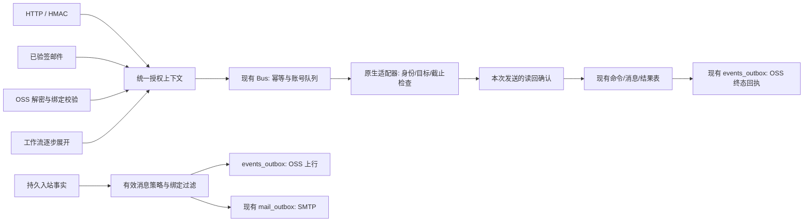

# QTrade 精简与鲁棒性整改设计

**状态：v0.3 评审草案，整体尚未批准实施；STS 局部对接已另行授权。** 本文不替代现行 00～07 正式规格，不预占新的 R6 裁决编号。安琳已确认的业务选择见 §2；未确认项保留分支，不视为默认批准。

基线：2026-10-13，`6c5b941` 加当前工作区未提交修改。依据为[32 项审查与证据](../../reviews/2026-10-13-code-review.md)、10 月 12 日询价定稿及本轮只读结构核对。v0.2 交付时仅有设计、边界、整改顺序和验收合同；随后安琳单独要求按 STS 说明改代码，局部实施及验证边界见 [STS 交接](../../handoffs/2026-10-13-sts-integration.md)，不据此批准其余方案。

## 1. 目标与取舍

目标是让已有功能的执行、状态和结果一致：允许的请求能够完成；拒绝或过期的请求不会后来偷偷执行；已经发出但暂时无法确认的消息不会被报成成功，也不会被自动再发一次。

采用**在现有模块内收敛职责**的方案：HTTP、邮件、OSS、工作流复用修正后的 Bus；命令、结果、消息、幂等和投递复用现有 SQLite 表；三通道适配器和当前 UI 保留。精简的衡量标准是减少重复状态、重复发送路径、无消费者订阅和隐式回退，不以删除行数为目标。

| 路径 | 成本与结果 | 选择 |
|---|---|---|
| 修正现有核心，再统一入口 | 修到根因；保留现有资产，迁移范围可控 | **推荐** |
| 各入口分别补丁修复 | 初期改动小，但四套权限、幂等、确认和重试会继续分叉 | 不采用为总体方案；界面局部缺陷仍就地修 |
| 重写服务、增加消息中间件或通用工作流框架 | 额外部署、运维与数据迁移，现有问题仍要重新解决 | 本轮不做 |

**本轮的复杂度约束：**默认不新增数据库表、不增加运行进程或基础设施；只增加持久正确性所需的少量字段和索引。若实现中发现现有表确实无法表达必要事实，须提出具体差距和替代成本，再修订方案，不能为了“零新表”滥用字段。

## 2. 安琳的决策记录

| 编号 | 问题 | 当前结论 |
|---|---|---|
| D1 | 交付范围 | **已确认**：工作台已有功能全部修稳；闭环已确认的企点询价、微信选群接收/转发；存款发送不改，未承诺能力后置 |
| D2 | 同一绑定的传输方式 | **已确认**：OSS、邮件二选一；不同绑定可以分别使用不同方式；询价固定 OSS |
| D3 | 动作已触发但结果未知 | **已确认**：显示“送达待核实”；自动只读对账；没有证据不自动重发；手动重发提示重复风险 |
| D4 | 询价时效 | **已确认**：生成起最多 5 分钟；发送方可缩短；过期且未开始发送的指令不补发 |
| D5 | 关闭正文采集后的自动处理 | **待确认**。推荐只留允许的元数据，同时停止该范围依赖正文的自动转发与回复。若允许“不在本地留存但瞬时外送”，必须单独定义许可与无法补投的代价 |
| D6 | 替换手写密码原语 | **AES-GCM 封套替换仍待确认**。安琳后续明确要求按 STS 说明改代码，本批使用 `cryptography` 及必要依赖实现 SM4-CBC 鉴权；此局部授权不包括替换原 AES-GCM 封套 |

无需再次确认的边界：已授权的 Dify 询价回复不逐条等待人工批准；成交红线、账号授权和正确目标仍然执行。无法证明目标、账号或密钥身份时停止该次发送/取钥，不把“是否接受错发”作为可选项。不自行重启业务账号、现有容器、WSL 或 Windows。

## 3. 功能边界

| 范围 | 本轮承诺 | 边界 |
|---|---|---|
| 工作台本地 | 三通道已有账号、收发、消息查询/导出、画面、资源、邮件和受控管理功能修稳 | 不重做视觉，不恢复退役的指令台/工作流/邮件模板页面 |
| 企点询价 | 绑定账号的消息、真实通讯录、已批准指令执行、同次读回和回执闭环 | 编辑后的正文原样发；同收件人多债合成一条；不补发明确作废的历史指令 |
| 微信存款消息 | 仅绑定微信的选中群接收与转发，复用锁定模板 | 空群列表不转发；私聊不进存款；新增群不自动进入白名单；存款发送保持现状 |
| QQ | 修稳已有本机收发、扫码、会话隔离与管理面生命周期 | QQ 新 OSS 下行/上行协议能力不因旧草案自动纳入 |
| 工作流和邮件命令 API | 保留现有合同，修复权限与执行边界 | 无前端页面不等于可以删除外部 API；不扩展工作流语言 |
| 外部询价/Dify/存款系统 | 提供三端合同样本与必须验证的消费结果 | 外仓未审，不能把工作台上传成功当作外仓已入库/已进入 Dify；必要对接由对应仓库承接 |
| 安装交付 | 构建及安装完整性门修复，形成同版本证据 | 微型 kcheck 根因与真实内核/安装验收单列；不因源码测试通过就宣称安装可用 |

依据：[询价定稿](../../handoffs/2026-10-12-企点询价发送通路.md)、[模态与入站要求](../../handoffs/2026-10-12-开始询价模态与消息入站.md)。014 的未决双投递和存款下行不覆盖 D1/D2。

## 4. 最小目标结构

这是一组既有模块的调用约束，不是新增服务。四个明确的事实持有方：

1. **授权**：认证入口构造服务端可信上下文，Bus/读取服务消费同一规则。
2. **执行与结果**：`commands + command_results + idempotency`，不是 Future、内存集合或 UI toast。
3. **消息事实**：`messages` 中本次消息与原生读回的关联；不是正文相同或按钮点击成功。
4. **投递事实**：现有出箱行；上传/SMTP 成功不等于外部业务已处理。

模块调整控制在已有 `api/auth`、`bus`、`store`、`ossbox`、`mail`、适配器及前端 store；只提取确实被多个入口共同使用的小函数/服务，不创建全仓通用事件框架或配置平台。

## 5. 授权：一次认证，执行前仍核权限

沿用现有能力目录和 read/write/admin 规则。新增的小型授权上下文至少表达：主体引用、认证类别、级别、账号/操作范围、来源、绑定约束和策略版本；只保留核验所需字段，不保存令牌或密钥。`origin.actor` 是审计标签，不是权限凭证。

- HTTP 的 Bearer 与 HMAC 分别完成认证；两者都落实其已配置的来源/账号/操作限制。旧 HMAC 密钥不能成为 Bearer 凭据。HMAC 宽限期通过版本化的现有 Vault 引用保留前后两把钥，旧/新签名都完整核时间、nonce、IP 与权限；到期旧钥失效。先写并验证新 Vault 条目，再在同一数据库事务切换有效引用及宽限登记；失败时旧引用仍有效，未被引用的新条目可精确清理，不能先覆盖现用钥再赌数据库写入成功。
- 邮件从真实路由、已校验发件人与签名生成权限；`route.level=read` 不得入队写能力。
- OSS 只从本地已启用绑定取得权限，不采信封套自报的角色。校验对象名与内容中的工作台、消费者、命令号、账号 UID、用途一致；本轮询价下行只开放已承诺的 `send_text`。
- 工作流启动检查步骤，执行和续跑使用“原运行权限上限 ∩ 当前主体权限 ∩ 本次续跑者权限”。定义版本改变时拒绝从新定义续跑旧任务；本轮不新增工作流版本仓库。
- 真正执行前再次检查权限、账号状态、当前 Gate 和截止时间。撤销权限或停止账号后，已排队请求不能继续外发。
- 读取的账号约束进入 SQL，再分页。邮件详情/队列控制均核冻结归属；无法确定归属的全局邮件仅对拥有相应全域权限的管理者开放，不能只看 admin 等级。

现行缺口与可复用入口：`api/auth.py:34`、`api/app.py:716`、`mail/catalog.py:38`、`mail/ingest.py:254`、`workflow/engine.py:185`；见 BE-05～09、14。

## 6. 执行、期限与真实结果

### 6.1 不再建立另一套状态机

保留当前命令五态、消息四态、幂等三态。界面按结果语义派生状态，不直接把 `commands.failed` 翻译为“肯定没有发送”。

| 事实 | 界面/业务显示 | 自动行为 |
|---|---|---|
| 指令对象已上传，尚无采集端结论 | 已提交，等待结果 | 缺回执不说明是否已受理/发送；只查询同一请求，协议允许的传输重试仍使用同一对象和期限 |
| 外端等待到期或通信中断，仍无确定回执 | 送达待核实（尚未取得工作台结果） | 不推断未发送，也不声称动作已经触发；继续收取迟到终态，不自动换键重发 |
| 排队中或尚未进入副作用 | 等待执行 | 到截止时间即撤销，后续释放队列也不得发送 |
| 权限、目标、截止等确定拒绝 | 发送失败，并说明原因 | 不伪装成待送达；重新发起必须保留原结果与新意图的区别 |
| 动作已触发，结果不可确定 | **送达待核实** | 自动只读对账；不自动换键重发；人工重发显示重复风险并记录 `resend_of` |
| 本次消息获得可靠新读回 | 已送达 | 关联本次命令、收件人与消息；询价端此时才进入询价中 |
| 已送达，回执上传失败 | 已送达，回执待投递 | 只重投同一回执，绝不重新执行发送 |
| 多收件人部分成功 | 每个收件人分别显示已送达/失败/待核实 | 不整单重发；成功的批次不再执行 |

`OK/202 accepted` 不等于 `DELIVERED`。自动询价使用读回确认；这与逐条人工批准无关。建议将既有 `SEND_CALLED_BUT_UNCONFIRMED` 同样用于微信未知发送，按 D3 修订其现行“无读回即可重试失败”的口径，而非再新增同义状态。

对一只债投给多人：推荐任一收件批次真实 delivered 后进入“询价中”，同时明确列出其它失败/待核实批次；没有任何已送达且有待核实者则显示“送达待核实”。这是评审建议，不能以整体 `ok` 覆盖逐批事实。

### 6.2 截止时间不可重新起算

询价协议携带受保护的 `created_at`、`expires_at`；`created_at < expires_at <= created_at + 5 分钟`，调用方可以缩短。上游在业务意图生成时固定期限，Dify 排队、OSS 重试、采集重启均不刷新期限。Agent 再取业务期限与本次执行预算的较早值，传给原生动作。五分钟约束的是开始发送；到期仍继续接收既有动作的迟到读回/ACK。外端等待显示建议以该期限为界转换为待核实，不能自行结案为发送失败。

截止检查至少在受理、出队、限速等待结束、输入正文前和发送前执行。动作已经触发时到期，按未知/真实读回处理，不假称安全取消。时钟异常不得通过重置收到时间延长指令寿命。

旧无期限对象不按“本次首次看到”赋新寿命：先隔离、列明数量和身份，仅核对既有结果，不自动执行；指定历史指令继续禁止补发。生产者合同升级完成前，不打开新自动下行。

### 6.3 三个短事务与一个执行权

1. **受理事务**：核真实身份、参数与幂等，原子登记命令和幂等占用；队列满/磁盘满不得留下“接受成功却没有可恢复记录”的半状态。
2. **发送前事务**：获得同账号执行权，重核状态/权限/期限，取得可信确认基线，预写本次 `messages.SENDING` 与副作用边界标记。提交后才调用 UI/OneBot/WinAgent，不在数据库事务内等待网络或界面。
3. **结果事务**：原子更新结果、消息关联、幂等结论和应投递的终态回执，再通知等待者。请求 Future 的结束不代表后台动作已经结束，也不能阻断后续只读对账更新真实结果。

进入原生线程/IPC 后，取消一个 Python Future 并不能停止线程。账号执行权必须保持到实际动作退出或进入受控不可用状态，不能一边显示超时，一边放下一条操作同一窗口。停止账号先拒绝新写入、撤销排队项，再处理在途动作；仍在停止时界面如实显示进度。

执行权同时落在真正操作窗口的 WinAgent/原生写入口，由它持有实际动作句柄。HTTP 超时、Agent 取消/重连不能释放该句柄；无法证明前一个动作已经退出时，该账号保持禁写。不能只在上层 asyncio 中加一把随进程消失的锁，也不因此额外建立一套原生业务队列。

已确定的成功或失败结果冻结，同键重投保持原 `ok/error`；同键异操作/异参数拒绝。未知结果可以凭本次新证据单向收敛到已送达，保留审计。现有“ABANDONED 无读回就删键再发”和“DONE 一律成功”必须删除。认证/格式校验前的拒绝不算受理；已受理并结案的业务重试作为新意图处理。依赖旧“同键条件修复后再执行”的调用方需同步合同，不能静默改变。

新键按服务端认证主体和来源归一，避免不同客户端相同短键碰撞；原始 `cmd_id/req_id` 仍保留供回执。键长度、参数摘要与兼容迁移需与现有128长度约束一并测试，不让调用方伪造其它主体前缀。

依据：`bus/bus.py:175`、`:187`、`:229`、`:253`；`store/schema_agent.sql:165`～229。

### 6.4 只确认“本次”消息

- QQ 优先使用本次发送返回的原生消息 ID，并绑定本次 `trace_id/msg_id`。
- 企点、微信取得目标原生库发送前水位及身份/库代际。不能仅取本地轮询 cursor，因为未采到的历史同文也可能晚于 cursor。
- 读回必须在本次可信基线之后，账号、目标、方向与内容摘要相符，并合并到本次预写消息行；旧同文不作证。
- 原生库重建、多个同文候选、另一终端同时发送同文或无法建立可信基线时，不猜测匹配。发送前无法核实则拒绝；动作后出现歧义则待核实。
- 同账号、同会话、同文的未决发送受到保护；手动重发必须明确是新意图和重复风险。自动生产者不能用 `manual=true` 自报越过此保护。重发仅由服务端识别的控制台授权入口创建：核原命令归属、当前未决状态与当前写权限，将风险确认绑定原 `trace_id` 和新请求摘要，记录确认人/时间及 `resend_of`；OSS/邮件和普通自动调用凭据不拥有该例外，也不接受外部自造解除标记。确认只解除该笔未决保护，账号、目标、Gate、期限仍重新检查。
- 人工重发后，原单迟到读回可能与新单同文。无法凭原生ID/可信证据唯一归因时，两者都不能按时间最近强配；一条读回不得同时确认两笔发送。

这里不承诺 UI 点击与数据库之间的数学 exactly-once；承诺的是：可判定的重复/过期不执行，不确定副作用不自动再做。

## 7. 复用数据表，限制新增数据

| 现有表 | 本轮使用与必要增量 |
|---|---|
| `commands` | 保留现有状态、`timeout_ms/submitted_ms`；新增原意图 `created_at/expires_at` 和固定执行截止，不能把收到时间当生成时间。拟加一个受控执行上下文（主体/来源/绑定引用及权限上限），副作用标记复用关联的预写发送事实，不重复维护第二套状态；额外取消字段仅在既有状态无法表达时增加。`origin_transport` 当前只允许 local/http/email，迁移显式扩充 oss，不伪装成 local |
| `command_results` | 补全现有结果落库的遗漏字段，必要时加 `error_reason/error_details_json`；确定结果重放保持语义，未知只允许有证据收敛 |
| `idempotency` | 保留 SENDING/DONE/ABANDONED 及现有唯一键；修结果与清理规则，不复制另一份内存结果账本 |
| `messages` | 预写本次发送行，拟加确认基线 `confirm_context_json`；经存量重复检查后为本次发送关联建立约束 |
| `events_outbox` | 复用现有投递状态、attempts、next_attempt_ms及 `(event_id,target)` 唯一约束；新增明确的 OSS message/ACK 目标。消息沿用匹配的消息事件，ACK 复用已有 `command_done`，不绕过 event CHECK；逻辑 event_id 由消息完整来源身份或命令 trace_id 稳定生成，不在重试时随机换号 |
| `mail_outbox` | 继续使用现有SMTP/模板/重试；冻结账号归属，绑定转发记录 binding_id，避免路由后来改变后权限无法判断 |
| `workflow_runs` | 保存原始授权上限并核已有 workflow_version；不新增版本仓库和语言能力 |
| `settings` / Vault | 新增狭窄集成配置与绑定结构，密钥仅使用既有凭据引用；现有其它配置不做全库搬家 |

`commands.args_json` 已规定不存正文明文，继续保持。新进程若拿不到原意图正文，不能凭脱敏参数拼造或补发。只有新协议证明未进入副作用、原请求仍有效且原文可从受保护来源重新取得并通过同一摘要/授权核验时，才允许安全恢复排队；其它项等待原请求重投或到期，以真实原因结束。旧版本记录缺证据时保守视为未决。

`events_outbox` 当前 target 无固定枚举约束，可扩充明确的 `oss:<binding_id>:message|ack`；Webhook仍只消费自身前缀。OSS 领取查询先过滤当前允许投递的绑定，再 LIMIT，不能让暂停积压占满一轮阻塞其它绑定。必须同时收紧 `maintenance.py:513` 的 `target <> 'ws'` 清理，并保护关联的 commands、idempotency、messages 和 mail_outbox，未决执行/未投递记录不按普通缓存TTL直接删除。绑定停用、隐私收紧或权限撤销时，尚未发起的投递暂停，不得借旧快照继续越界；已经进入外部 IO 的请求无法承诺撤回，单独核对结果并阻止后续重试。

**回执选最简单的协议：**本轮固定 `ack/<cmd_id>.bin` 只投递一次逻辑上的确定终态。未知时保留工作台本地待核事实，外端按 §6.1 区分“等待结果”和“未取得结果的待核实”，不能由缺 ACK 推断动作阶段；读回确认后才投终态 ACK。传输重试冻结同一封套字节与对象名，不重新执行发送。暂不引入可被乱序覆盖的多版本 ACK 或新结果事件通道。D3 比 10 月 12 日“没有回执就失败”的旧口径更新，方案获批后双方同步改正式合同；未完成消费者配套前不开新自动下行。

**唯一投递来源确定为同事务登记：**入站消息的实际写入/去重合并、采集游标与符合策略的 OSS/邮件出箱行在同一事务完成；命令终态、幂等与 ACK 出箱同一事务完成。将现有 Store 写入拆成可组合的事务内操作，网络工作仍在事务外。WS emit 只是提交后的界面通知，不作为可靠投递来源；不另加扫描游标、双来源补偿器或重放 WS 历史的后台任务。

事务内只登记符合 D5 的投递快照及固定目的/协议/密钥版本引用；投递方成功加密后先在同一出箱行持久冻结封套字节，再发起 PUT，重试使用同一对象和字节。冻结前未发网络，冻结后不重新生成随机 nonce。临时凭据故障使投递保持 pending 并报警，不把加密放在采集事务内阻塞本地消息；出箱容量耗尽则触发明确背压，不提交无可靠投递记录的采集水位。未启用/配置不完整的集成不登记投递，页面明确显示未开始接收转发任务。

## 8. 配置、绑定与投递

### 8.1 一份真实配置，三种清楚的动作

新集成的运行配置、绑定和非敏感状态由后端持有，按现有 settings/凭据引用能力实现；浏览器缓存仅保留界面偏好。Agent正式启动从同一来源装配，不依赖开发Shell手工export。环境变量兼容导入只能是显式一次性迁移，并记录来源，不能持续盖过页面保存值。

保存、测试、启用分别表达事实：

- **保存**：校验并保存非敏感参数及密钥引用，不开启收发；返回配置版本。最小方案要求被编辑绑定处于停用状态；活动绑定变更先明确暂停及积压处置，不引入全平台双写配置系统。
- **测试**：使用指定配置/route_id。默认只读网络与授权检查；若验证对象写权限，界面明确说明使用受控测试对象，不发送业务消息。测试不能顺手保存并启用邮件。
- **启用**：完整校验凭据、绑定、模板、收件人及依赖，然后装配；返回运行版本和健康状态。失败显示“未启用/依赖不可用”，不以保存或TCP连通冒充可用。

配置未齐只停该集成，不阻断本地采集与其它绑定。环境页/邮件页显示配置来源、保存版本、运行版本、最后成功时间、待投递量和固定脱敏错误原因；不再展示一个笼统的绿色“测试通过”。

### 8.2 绑定是最小业务单位

绑定至少包含：消费者、工作台、通道、稳定账号UID、明确会话范围、传输方式、目的路由引用及启用/版本信息。昵称和备注只展示。询价账号的全部相关消息可上行；存款仅所选微信群。入向和出向有明确标记，消费者不得把本方出向再当入向自动回复。

模式切换只影响当前绑定。切换后不把积压消息自动改发新出口；已排队对象冻结原归属/目的和绑定版本。推荐变更步骤为停用→等待在途投递结束/核实→列出积压→显式选择恢复旧出口补投或放弃这些旧投递→编辑并启用新配置；不提供自动搬到新出口的捷径。放弃仅关闭投递并保留必要审计，不抹去消息/发送事实。未处置积压则保持暂停，不能一边换配置一边保留无可用路由的旧任务。新启用从明确水位开始。临时断网与主动停用不同：绑定仍启用且条件允许时，断网投递可继续排队和重试；主动停用不默默补发停用期间历史。以上是待整体评审的技术默认，不冒充 D2 已明确确认的积压政策。

停用先拒收该绑定的新转发工作并停止领取积压，原生采集按已有策略继续；有未退出的投递则保持“停止中”，不进入修改步骤。旧积压补投必须使用原目的、原绑定版本及仍有效的凭据；不能修改同一 `secret_ref` 偷换其密钥，也不能在原邮件路由消失时回落全局路由。按前述先排空或明确放弃再修改，可避免建设通用配置版本仓库；保存、测试、启用仍是独立动作。

询价端继续负责 Dify。工作台上行提供完整来源身份、方向、原生消息 ID 与可比较的会话顺序；询价消费端对每条入向固定同一绑定/账号/会话、在其之前最近一条已确认出向的 `prior_outbound_text`，并按入向消息 ID 幂等调用，不以稍后到达的新出向改写旧上下文。乱序缺口未补齐时等待可用证据或显式标缺失，不能拿其它会话、未确认出向或未来消息凑值；受 D5 正文策略约束。此项是三端必验合同，外仓实现现状尚未核验。

每条消息使用完整来源范围加原生消息ID去重，不能假定 ext_msg_id 跨账号唯一。消息内容长度、封套大小、单轮读取/处理量设置有界限制；超限明确拒绝，不截断报价、不拆成多条。

### 8.3 邮件与目录

邮件使用既有 mail_routes/mail_outbox：出站认证引用、收件人、绑定、模板必须完整，IMAP成功不代表SMTP可用。锁定 `ibquote-163-v1`/`collector-v1` 字段，不另写一套模板。只有符合现行高清/原图规则时转发图片，跳过要显示明确原因。

目录复用现有只读联系人/群查询，按当前索引+分账号分片与消费者对齐版本。先生成可用分片，再发布引用它们的索引；读取失败、真实空目录、陈旧快照分别表示。内容摘要包含密钥版本/协议版本影响；设置受控周期刷新，不能永远只等明文变化，也不能发布指向不存在对象的就绪索引。

网络调用离开主事件循环，使用固定有界并发和明确请求/单轮预算；线程中不访问SQLite。每轮增量分页、限制对象量、隔离单对象错误；业务过期与传输重试分开。取消线程等待不等于远端PUT没发生，故PUT重试只处理同一不可变逻辑对象，不触发业务发送。

## 9. 账号、密钥与桌面边界

### 微信

在选择目标后、输入正文前、发送前校验预期账号、目标会话、窗口前台和输入控件；不能仅凭唯一显示名、坐标点击或发送后读回补救。UIA/版本条件不足时，读取可继续，发送明确不可用，不继续叠坐标兜底。

历史密钥按确定wxid/数据目录/格式版本复用，并证明实际可解密；新账号不能借另一账号 `history[0]` 的两把非空钥跳过取钥。同账号经验证缓存允许复用，降低不必要的取钥工作。

同字节DLL被锁可复用；不同字节无法落位时，不自动重启微信、不把请求DLL记成实际DLL。推荐阻断本轮换候选，保留已验证的读取服务并给出可执行诊断。此项需在方案批准后修订R6-100的真实身份口径。

### QQ

恢复R6-83规定的受管容器归属、实际ACCOUNT与WebUI收尾；只在用户发起的当前登录尝试内进行，关闭管理面且新连接确认同UID后才running。修正健康观察对预期重连的误报，不删掉收尾步骤避开错误。临时WebUI的真实开关、到期、失败重试一致；不能清空到期登记冒充已关闭。

二维码按账号+登录尝试归属；新尝试清掉旧码，旧事件和迟到HTTP都不覆盖当前尝试。仅同一尝试的无图历史回放可按协议保留当前有效图；正文、二维码和密钥各自遵守存储边界。

### Agent 与 WinAgent

生命周期持有恢复、账号、投递和原生动作任务：先draining，再有界等待/取消，再关适配器和数据库。关库后不得继续创建任务或写库；停Agent不等于停全部业务容器。

管道已连接阶段也在重连循环内；清理旧连接后退避重连，区分重连传输与重新登录业务账号。仍在运行的原生线程不能因上层Future取消就释放执行权或标成已安全取消。

## 10. 前端就地修复与可删除内容

| 修复 | 最小做法 |
|---|---|
| 视频地址 | HTTP、events、stream共用现有Agent origin解析；不增加第二份端口配置 |
| 查询串结果 | messages/sessions按稳定查询键和代次更新结果/游标；旧响应取消或忽略 |
| 导出 | 根据真实Job取得授权下载字节，按CSV格式/MIME保存；不将URL写成ZIP |
| 自启 | IPC明确返回操作结果或实际状态，页面、持久配置、OS回读一致 |
| 可见性 | 补真实show/hide/minimize/restore事实和首次状态；隐藏暂停，恢复复用当前流 |
| 无用状态 | 删除已无页面消费者的commands/workflows订阅和缓存；先查引用，不裁撤后台API |
| OSS重复实现 | 删除被Bus替代的独立发送、读回、内存结果/去重逻辑，保留协议解密和传输 |
| 工程杂物 | 按来源/在途用途精确归档临时脚本，保留历史证据和运行数据；不做宽泛清理 |

不为局部竞态引入全局状态框架；不为配置错接重写整个前端；不把目录迁移与安全/功能修复绑在同一批。

## 11. 正文、加密与保留期

D5 未确认前按推荐分支设计：有效正文策略按会话→账号→全局最近显式值解析。有效关闭时，采集正文、raw_ref及其派生持久事件/自动转发不得落到受限存储或出口；允许的ID、时间、类型、长度和匹配摘要可保留。开关展示有效值及继承来源，不把全局缺省误作不可覆盖的总禁令。

主动提交的发送命令仍遵守现有“commands不存正文明文”的独立合同；不能借自动恢复把正文补写进命令参数。有效隐私关闭时，自动正文处理被暂停的原因必须可见。以后重新开启不默认重放关闭期间历史。

若D5选择瞬时外送模式，本稿这一部分必须重审：明确独立许可、具体出口和内存缓冲上限；密文落盘仍算保留，不能用加密出箱偷换“不留存”；断网/重启后不能承诺自动补投。不会把该新模式暗藏在capture_text里。

以下 AES-GCM 替换仍属待评审方案。D6 的封套替换获准后，选用 `cryptography.hazmat.primitives.ciphers.aead.AESGCM` 替换内部实现，保留 `seal/open_sealed`、既有密封字节合同（nonce12 + ciphertext + tag16，AAD为空）及统一失败异常。该 API 支持现有三种密钥长度且输出包含16字节tag，接口匹配；实际旧/新互通仍需证明。本批 STS 仅使用该库的 SM4-CBC，不更改本段封套。[官方 API](https://cryptography.io/en/50.0.2/hazmat/primitives/aead/#cryptography.hazmat.primitives.ciphers.aead.AESGCM)

选型比较中 `cryptography` 需要 `cffi/pycparser`，PyCryptodome 依赖闭包更小但适配参数更多；推荐前者以缩小需要维护的密码调用面。STS 局部实施已锁定 `cryptography==50.0.2` 及必要依赖，目标 Python/rootfs 的 wheel 与产物验证按 STS 交接单独留证；不把依赖引入等同于 AES-GCM 兼容验收。当前构建可以联网预装，不据此宣称构建本身全离线。[官方安装说明](https://cryptography.io/en/50.0.2/installation/)

验收覆盖 AES-128/192/256、空正文、块边界和业务上限：公开已知答案、固定nonce旧/新字节一致、旧封新开/新封旧开；篡改nonce/正文/tag、错钥、截断和追加内容全部拒绝且无明文泄露。旧实现只作测试参照，生产中不保留失败后回退手写实现的分支。目录密钥轮换/对象版本另行管理，不混成密码格式重写。

保留期按数据类别管理：WS历史不是可靠投递队列的保留期。未决命令、必要去重与关联证据不能被普通TTL误删；正文仍服从独立隐私/保留期限，正文过期后保留最少未决元数据并如实显示证据不可用，不能删键恢复自动重发。复用现有账号队列上限并对出箱设置容量水位，达到上限停止接受新的待投递工作并显式报错；不得以“不确定”无限积压。隐私关闭/绑定停用时尚未开始的投递暂停或按既定政策清除；在途请求按 §7 核实，重新启用不自动解除旧积压的处置要求。

## 12. 兼容、迁移与回滚

1. 先形成正式裁决及三端样例合同，再添加向后读取兼容的字段/索引；默认关闭尚未接通的集成入口。
2. 迁移前备份并核存量重复trace、未决消息、旧OSS对象；新约束遇到真实重复不得直接删除数据以求迁移通过。
3. 结构DDL和schema_version同一迁移事务落盘。旧数据缺少副作用/水位证明时不能补造“未发送”标记。
4. 新询价期限、待核实展示、确定终态ACK、目录分片和主体幂等命名需要生产者/消费者共同验收，再逐绑定启用；旧客户端不靠静默兼容分支继续危险重放。
5. 没有新外部副作用时，可在核验后成对恢复代码和库；升级后发生过真实外发，就不能恢复旧库丢掉幂等事实。优先前向修复，必要降级必须保留新执行记录并阻止自动重放。
6. 安装清单在最终签名后逐文件生成，定义required_files。删console目录、缺DLL、改app.asar任一均拒绝；外壳签名不替代解压目录完整性。
7. 新源码不属于旧1.0.1包；微型kcheck、内核切换、真装与真实账号验证分别留证。不把未证的/init猜测写成已修根因。

## 13. 实施顺序与32项覆盖

这是供评审的交付顺序，不是已授权实施的任务清单。批准设计后再拆成可独立验收的小批。

| 批次 | 范围 | 关闭的问题 |
|---|---|---|
| A 安全与策略 | 统一授权、读取范围、正文有效策略、目标前置验证 | BE-05/06/07/08/09/10/14，FW-01 |
| B 执行事实 | Bus受理/截止/取消/未知、结果重放、预写与确认、OSS接总线、回执分离 | BE-01/02/03/11/12 |
| C 身份与生命周期 | 微信钥/DLL、QQ收尾、Agent任务归属、WinAgent重连 | FW-09/10，BE-13，AR-08/09 |
| D 配置和上行 | 生效配置、绑定、真实目录、邮件完整配置、指定路由测试、有界网络、目录刷新 | FW-03/04/05，BE-04/16/17，AR-07 |
| E 前端与清理 | endpoint、二维码、查询竞态、导出、自启、可见性，删除无用订阅/重复路径 | FW-02/06/07/08/11/12 |
| F 安装与整体交付 | 逐文件清单、精确迁移、冻结全量和跨端验收 | BE-15，加前述全部回归 |

A/B中发送安全先完成，再开自动下行；C可独立并行，D依赖B的可靠结果与D5政策。E局部修复可以并行，但最终必须同一冻结版本验证。BE-16只关闭已批准的上行与选群转发部分，未批准QQ新OSS/存款下行明确排除，不写成“已修复”。

## 14. 验收矩阵与完成定义

| 边缘场景 | 独立可观察判据 |
|---|---|
| HTTP/邮件/OSS/工作流越权、权限撤销 | 全部零适配器副作用；无越权正文；限权分页可遍历全部有权记录 |
| HMAC宽限轮换、Vault/DB任一步失败 | 旧/新签名仅在有效期内通过完整验证；旧钥永不作Bearer；失败不破坏现用凭据 |
| 同键100次并发/同键异参 | 至多一个有效执行；异参拒绝；确定失败重放保持失败 |
| 排队、限速等待、输入前截止/取消 | 被截止的请求之后不发送；预算不重新起算 |
| 受理、预写、进入动作、返回、读回、ACK六处崩溃 | 确定未执行与未知分开；未知不自动重发；回执重试不增加发送次数 |
| 历史同文、晚采旧消息、库重建、多个同文候选 | 不误确认本次消息；存在歧义保持待核实 |
| 未知原单→人工重发→原单迟到读回 | 非控制台凭据不能取得重发例外；不按时间强配，一条读回不确认两笔发送 |
| 点击未导航、焦点抢占、账号/钥/DLL错误 | 可识别的发送前异常零正文输入/零发送；身份与成功档案一致 |
| 新旧登录尝试、迟到HTTP/WS | 新尝试不继承旧码，旧事件不改当前状态/身份；同尝试正常刷新 |
| 多收件人部分结果、回执上传失败 | 逐批展示，成功批次不重做，ACK仅投同一终态 |
| 断网、主动停用、切换绑定、隐私关闭 | 各自语义明确；不暗改出口、不漏施权限，不自动补发无期限旧指令 |
| 消息写入/出箱登记之间崩溃、事件TTL清理 | 消息和投递同成同败；采集水位不越过未提交消息；WS清理不删未投递数据 |
| 询价入向乱序、重复、上一出向未确认 | 不串账号/会话/未来正文；重放使用固定上下文，不重复触发Dify |
| 目录失败/真实为空/对象被删/换钥 | 不伪造空成功，不发布缺对象的索引；可刷新、恢复、诊断 |
| SMTP凭据/收件人缺失、测试路由 | 缺条件不启用；只测指定路由；测试不启动收发 |
| 慢网络与原生线程、停机/重连 | API/WS持续响应，待处理量有界；关库后零写入；仍活线程不释放执行权 |
| 旧查询、导出、自启、隐藏/恢复 | 结果始终属于当前筛选；文件字节/MIME正确；配置与OS一致；无重复流/隐藏轮询 |
| 缺安装目录、坏DLL/app.asar、迁移中断 | 安装/迁移门真实失败；历史幂等不丢；不能靠跳过门通过 |

开发者回归、独立验收、文档和只读终审分工保留。已知缺陷应先有有效失败的回归，再由相同判据证明修复。最终在同一源码/依赖/产物冻结下运行 Agent、WinAgent、安装器 Python 全量，Pester、前端单测/类型/lint/build、Fake HTTP/WS 联调及 Playwright；记录命令、运行根、SHA、退出码和日志，32项逐条关闭或明确范围归属。真实 Electron、安装/kcheck、账号只读链路及获准的发送场景分别留证，未授权/未覆盖项明确保留，不用Fake结果代替。只有约定验收范围全通过才能报告“该范围内未发现回归”，不作不可证明的绝对零缺陷承诺。先做必要专项，再完整回归，不反复跑无关全量。

## 15. 本轮评审与待决项

- D1～D4 已确认；D5 仍待回复。D6 的 AES-GCM 封套替换未获准；后续 STS 指令只授权实现其 SM4-CBC 鉴权及必要 OSS 接线。
- 独立 critic 首轮提出六项合同修订，v0.2 已全部承接；限定复核结论为 `READY_FOR_USER_REVIEW`，没有残余技术阻断。该结论仅表示方案可供评审，不是实现验收通过。
- v0.2 设计交付时的静态核对：32项编号全部映射且无重复；当时原审查538个输入哈希无漂移；文档真值表检查 exit 0。以上是 STS 实施前证据，不代表当前业务文件仍无修改或新代码已通过回归。
- 2026-10-13 局部实施：安琳要求参照根目录 `STS接口调用说明.html` 改代码，并确认 `nytoken.yingmi.cn` 尚未就绪、先留接口。默认预留 `https://nytoken.yingmi.cn/api/sts` 且可配置，当前仅环境变量装配；未闭环 §8 的后端生效配置/UI 保存方案。实现、依赖和假服务验证见 [STS 交接](../../handoffs/2026-10-13-sts-integration.md)，真实联调后置，不宣称全部32项已修复。
- 请安琳重点审阅 §2 的两项待决、§6 的发送结果与有效期、§8 的停用/换出口积压规则及 §13～14 的范围与验收。整体方案尚未批准。
- 除明确授权的 STS 局部实施外，其余方案仍待评审；不改正式R6裁决，不自动提交或推送。
